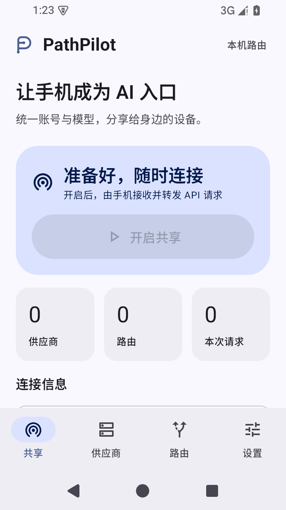
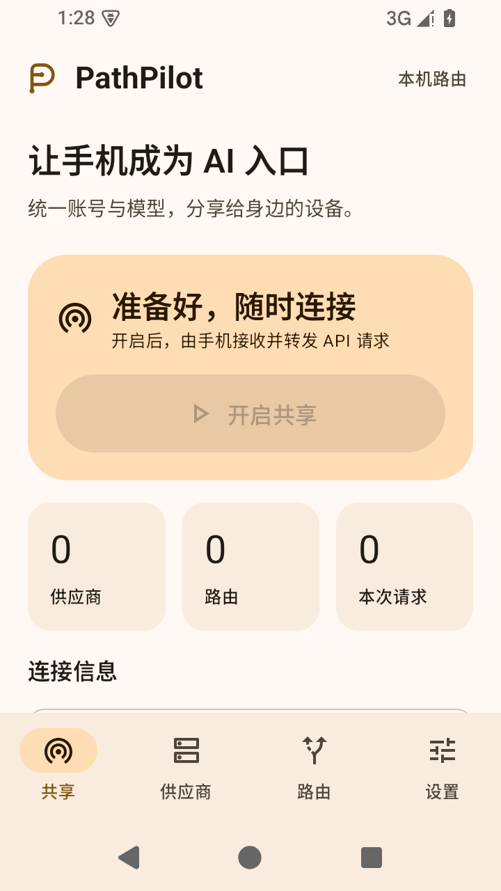
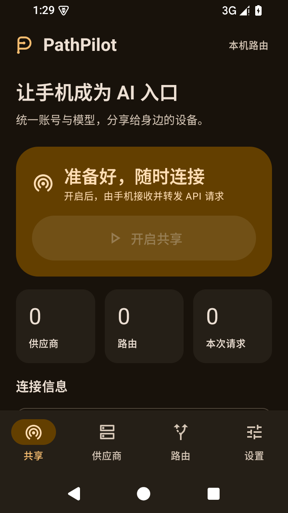

# PathPilot 0.1.1 · Android 运行截图

以下为 Android 15 / API 35 模拟器中实际运行的原始 720×1280 PNG，不是设计稿或合成图片。应用使用官方 Material 3 Expressive + 系统 Monet；测试包为独立 `.capture` 变体，正常交付仍仅 ARM64。

| 截图 | 实际展示 |
| --- | --- |
| [01 · 系统蓝色浅色](01-home-blue-light.png) | 共享主页，系统原始蓝色调色板 |
| [02 · 系统琥珀浅色](02-home-amber-light.png) | 同一 APK、同一页面跟随系统调色板变化 |
| [03 · 系统琥珀深色](03-home-amber-dark.png) | 同一调色板的深色界面与系统栏 |
| [04 · 选择供应商来源](04-provider-types.png) | Codex 订阅、DeepSeek 和兼容 API 三种来源 |
| [05 · DeepSeek 配置](05-deepseek-form.png) | 全屏原生表单及固定底部操作 |
| [06 · 缺少密钥校验](06-provider-validation.png) | 空 Key 提交被阻止，顶部显示具体错误 |
| [07 · 密钥与模型](07-provider-models.png) | 密钥掩码、可选模型列表测试和模型选择 |
| [08 · 保存后的路由](08-saved-route.png) | 测试供应商及 deepseek-chat 路由，强制停止后重新打开仍保留 |

截图中的 `QA-Test-Only` 和密钥均为本地测试占位数据；没有使用真实账号、没有发起上游生成或模型读取请求。共享未启动。截图包与正常安装包的数据隔离。结束时仅清除截图包占位数据并恢复系统主题；删除界面流程未完成手工验证。

运行环境采用无 KVM 的软件模拟。主题热切换、重启后首次打开编辑器分别出现一次输入超时 ANR，线程记录显示绘制/首次布局和明显的 JIT、系统调度压力；后续主线程已恢复空闲，未确定应用层阻塞原因。两次事件均记入[验证记录](../../../docs/validation.md)，这些正常截图不等同于已验证真实设备响应性能。

## 预览

| 系统蓝色 | 系统琥珀色 |
| --- | --- |
|  |  |

| 深色模式 | 添加供应商 |
| --- | --- |
|  |  |
