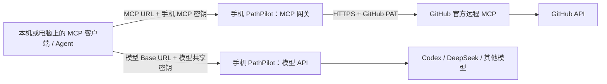

# 在手机上使用 MCP：GitHub 接入与实现方式

核查日期：2026-11-27（香港时间）。PathPilot 当前实现远程 Streamable HTTP Tools 客户端与共享网关。本文说明手机实际负责的工作、GitHub 配置方法，以及从官方规范、Codex、Magpie、CC Switch 得到的实现取舍。

## MCP 在哪里运行

连接 GitHub 官方远程 MCP 时，**GitHub MCP 服务运行在 GitHub，PathPilot 的连接管理和共享网关运行在手机**。手机通过 HTTPS 使用它。



三者分工来自 [MCP 官方架构][spec-architecture]：服务提供工具，MCP client 维护连接，host 负责模型与工具之间的执行流程。PathPilot 当前没有内置完整 Agent 对话循环；手机上的其他 MCP 客户端或电脑上的 Codex 等 host 负责发现工具、把工具交给模型、执行调用，再把结果交回模型。

第三方软件需要同时支持模型 API 和 MCP：模型填写 OpenAI 兼容入口，GitHub 工具另填 MCP 入口。当前 `/v1/chat/completions`、`/v1/responses` 负责模型转发，工具执行由上述 host 完成。

## 用当前 App 配置 GitHub

GitHub 官方 [README][github-readme] 同时提供 OAuth 与 PAT 两种远程接入方式。当前 App 已实现 Bearer，因此先使用 PAT；GitHub OAuth 登录按钮属于后续工作。

1. 在 GitHub 的 [Personal access tokens](https://github.com/settings/personal-access-tokens) 中创建令牌，选择需要访问的账户、仓库和操作权限。令牌的权限决定 GitHub 工具实际可以做什么。
2. 打开 PathPilot 底部「MCP」，添加连接并填写下表。令牌字段只填令牌本身，App 会添加 `Bearer ` 前缀。
3. 保存，进入连接并点击「获取工具」。App 会发送 `initialize`、`notifications/initialized`、`tools/list`，然后显示实际目录。
4. 选择需要共享的工具，保持连接启用，打开「MCP 共享」。
5. 在连接详情选择「本机」或「局域网」，复制完整 MCP 地址及 **MCP 访问密钥**，填入支持 Streamable HTTP 的客户端。

| App 字段 | 填写值 |
| --- | --- |
| 名称 | `GitHub` |
| URL | `https://api.githubcopilot.com/mcp/` |
| 认证 | `Bearer` |
| 令牌 | GitHub PAT，例如 `github_pat_…`，保留其原本格式 |

GitHub PAT 保存在手机，供手机访问 GitHub；客户端使用手机生成的 `sk-…` MCP 密钥访问 PathPilot。模型共享另有独立密钥与端口。

GitHub 官方还提供 `https://api.githubcopilot.com/mcp/readonly` 及指定 toolset 的路径。只查询代码时可以选只读入口；需要修改 issue、PR 等操作时使用相应工具与令牌权限。PathPilot 的逐工具开关控制对下游共享的工具，不替代 GitHub 的账户权限。[远程端点与 toolsets][github-remote]

GitHub 官方推荐 fine-grained PAT，可限定仓库并按用途选择 Contents、Issues、Pull requests、Actions 等读写权限；具体以所用工具对应的 GitHub API 权限为准。组织启用了 PAT 审批或 SSO 时，再完成相应步骤。[权限与组织策略][github-policies]

「获取工具」读取目录，GitHub API 在实际调用时检查 fine-grained PAT 权限。可先用客户端读取一个目标仓库的文件验证访问，再启用需要的写入工具。[工具目录与权限过滤][github-scopes]

## 在其他设备配置客户端

下面的 IP、连接 ID 和端口仅为示例，应复制手机页面的实际值：

| 使用位置 | MCP URL | 认证 |
| --- | --- | --- |
| 手机自身的 MCP 客户端 | `http://127.0.0.1:8318/mcp/<connectionId>` | `Bearer <手机MCP密钥>` |
| 同一局域网的电脑或其他手机 | `http://192.168.1.50:8318/mcp/<connectionId>` | `Bearer <手机MCP密钥>` |

电脑上的 Codex 可以在 `config.toml` 使用其官方支持的 HTTP 配置字段：

```toml
[mcp_servers.pathpilot_github]
url = "http://192.168.1.50:8318/mcp/<connectionId>"
bearer_token_env_var = "PATHPILOT_MCP_KEY"
```

在启动 Codex 的环境中将 `PATHPILOT_MCP_KEY` 设置为手机页面的 MCP 访问密钥。若客户端提供图形界面，直接填写同样的 URL 与 Bearer 密钥即可。Codex 配置中的 `url` 对应 Streamable HTTP；`command`、`args` 对应运行 Codex 的设备上的 stdio 进程。[Codex 配置类型源码][codex-config]

手机到 GitHub 的请求沿用 PathPilot 的上游代理设置。手机 VPN 对本 App 生效时，外网请求使用该 VPN；入站局域网访问仍需由手机网络和 VPN 的局域网设置允许。

## 当前实现与真实联调的区别

当前源码已经具备 GitHub PAT 方案所需的完整 URL、Bearer、HTTP POST、JSON/SSE 响应、工具分页和共享转发；这些路径已用离线上游验证。具体实现见 [McpClient](../core/src/main/kotlin/dev/pathpilot/core/mcp/McpClient.kt)、[McpGatewayServer](../core/src/main/kotlin/dev/pathpilot/core/mcp/McpGatewayServer.kt)、[McpService](../app/src/main/java/dev/pathpilot/app/runtime/McpService.kt)。

PathPilot 当前请求并只接受 `2025-11-25`。2026-11-27 的无凭据初始化尝试在云环境代理 CONNECT 阶段得到 `403 Forbidden`，未到达 GitHub。本次未使用用户 PAT，托管服务的版本协商和账号工具调用仍待联调。

所核查 GitHub 版本的 [go.mod][github-module] 使用 MCP Go SDK v1.8.0，该 SDK 的 [支持版本][go-versions] 包含 `2025-11-25` 与 `2026-07-28`，[服务端默认行为][go-server] 按客户端版本处理初始化。这说明源码具备当前 App 所需的版本路径；托管部署的版本集合以实际响应为准。

联调时按「获取工具」的具体结果处理：HTTP 401 检查令牌；GitHub 返回的 403 结合响应检查账户或组织策略；版本不匹配则记录服务版本并实现对应协议适配。代理 CONNECT 失败归于连接阶段。

## Codex、Magpie、CC Switch 分别可以借鉴什么

| 项目 | 已核查的 MCP 行为 | PathPilot 的采用方式 |
| --- | --- | --- |
| [Codex][codex-config] | host 维护 MCP 连接，将工具转换为模型可调用工具；支持 stdio、HTTP URL、Bearer 环境变量、headers 和单独的 OAuth 登录流程。 | 参考连接配置、工具调用边界和 OAuth 流程。当前先让 Codex 等客户端负责模型与工具执行循环；将来手机内增加 Agent 时，再实现这部分 host 能力。 |
| [Magpie][magpie-router] | MCP router 提供统一 HTTP 入口；连接远程 HTTP，也可启动并复用本机 stdio 进程；按来源和工具控制共享，关闭时回收自己启动的进程。可集中 OAuth 登录，向客户端分发本地代理入口。 | 当前远程网关方向与其一致。参考来源分组、工具开关、调用记录和集中认证；PathPilot 暂时保留每连接一个入口，不把聚合目录写成已完成。 |
| [CC Switch][cc-service] | 保存统一配置，并同步写入 Codex、Claude 等客户端自己的配置文件；连接检查可以启动 stdio 程序或连接 HTTP/SSE。 | 参考供应商/连接管理、表单和状态一致性。Android App 无法直接改写电脑上客户端的配置，先提供可复制入口与配置片段。它的桌面配置同步不等于手机工具运行时。 |

源码证据：Magpie 的 [`dialStdio` / `dialHTTP`][magpie-hub] 和 [集中登录后的代理配置][magpie-signin]；CC Switch 的 [Codex TOML 转换][cc-codex] 与 [连接检查][cc-connectivity]；Codex 的 [工具执行 handler][codex-handler] 和 [OAuth 登录入口][codex-login]。本次为源码核查，没有运行这三个参考项目。

## Android 后续实现顺序

1. **远程 HTTP 继续完善**：先完成 GitHub PAT、Microsoft Learn 等真实服务握手与工具目录记录，再加入「从目录添加」预填入口。目录添加复用现有编辑器、代理、存储和共享服务。
2. **集中 OAuth 登录**：按 MCP 的受保护资源元数据和授权服务器发现定位登录端点；支持服务要求的客户端注册方式，用 Android 浏览器 Custom Tabs 完成 Authorization Code + PKCE，再把令牌保存在已有加密配置中。AppAuth-Android 可承担原生授权流程，但 MCP 发现、`resource` 参数和服务适配仍由本 App 实现。[MCP 认证][spec-auth] · [AppAuth-Android][appauth]
3. **具体手机本地工具**：例如用户选定文件的读取或手机状态查询，先实现原生 Kotlin 工具，复用 Tools 网关和 Android 文件授权，避免为少量工具引入整套脚本环境。
4. **通用本地 MCP 包**：确有 Node/Python/原生程序需求后，再评估内嵌运行时、ARM64 Android 构建、依赖下载、stdio 与服务生命周期。原生程序需面向 Android 的 ABI 和系统库构建；`.mcpb` 提供包格式，所需运行时由宿主配套提供。

OAuth 使用本应用注册的 client ID 和回调地址。GitHub 官方 [Host Integration][github-host] 明确当前不支持动态客户端注册（DCR），需要注册 GitHub App 或 OAuth App。MCP 2025-11-25 的回调 URI 约定为 HTTPS 或 localhost，Android 可评估已验证的 HTTPS App Link。授权方式按原生应用设计，需保密的静态 client secret 放在服务端。GitHub 该篇文档仍含旧 PKCE 状态措辞，实施时以实际授权服务器元数据和当前注册配置核对能力。

远程目录、官方参考服务器与 MCPB 的详细来源见 [官方 MCP 来源与快捷接入](mcp-catalog-research.md)。上面的顺序是实施建议，不改变当前 App 的已验证范围。

[spec-architecture]: https://github.com/modelcontextprotocol/modelcontextprotocol/blob/b0be8f0f2481be8d5ea5294cf3fa57cd03cedc48/docs/specification/2025-11-25/architecture/index.mdx
[spec-auth]: https://github.com/modelcontextprotocol/modelcontextprotocol/blob/b0be8f0f2481be8d5ea5294cf3fa57cd03cedc48/docs/specification/2025-11-25/basic/authorization.mdx
[github-readme]: https://github.com/github/github-mcp-server/blob/7edc2dd123a8923db389de8772170663cb2d8e17/README.md
[github-remote]: https://github.com/github/github-mcp-server/blob/7edc2dd123a8923db389de8772170663cb2d8e17/docs/remote-server.md
[github-policies]: https://github.com/github/github-mcp-server/blob/7edc2dd123a8923db389de8772170663cb2d8e17/docs/policies-and-governance.md
[github-scopes]: https://github.com/github/github-mcp-server/blob/7edc2dd123a8923db389de8772170663cb2d8e17/docs/scope-filtering.md
[github-host]: https://github.com/github/github-mcp-server/blob/7edc2dd123a8923db389de8772170663cb2d8e17/docs/host-integration.md
[github-module]: https://github.com/github/github-mcp-server/blob/7edc2dd123a8923db389de8772170663cb2d8e17/go.mod
[go-versions]: https://github.com/modelcontextprotocol/go-sdk/blob/v1.8.0/mcp/shared.go
[go-server]: https://github.com/modelcontextprotocol/go-sdk/blob/v1.8.0/mcp/server.go
[codex-config]: https://github.com/openai/codex/blob/32119bac269b881d512b82df74af285e8c60adc2/codex-rs/config/src/mcp_types.rs
[codex-handler]: https://github.com/openai/codex/blob/32119bac269b881d512b82df74af285e8c60adc2/codex-rs/core/src/tools/handlers/mcp.rs
[codex-login]: https://github.com/openai/codex/blob/32119bac269b881d512b82df74af285e8c60adc2/codex-rs/cli/src/mcp_login.rs
[magpie-router]: https://github.com/yetone/magpie/blob/e66d872a8eaecc285b0d597917d6b520035712ec/docs/subsystems/mcp-router.md
[magpie-hub]: https://github.com/yetone/magpie/blob/e66d872a8eaecc285b0d597917d6b520035712ec/internal/library/mcp_hub.go
[magpie-signin]: https://github.com/yetone/magpie/blob/e66d872a8eaecc285b0d597917d6b520035712ec/internal/library/mcp_signin.go
[cc-service]: https://github.com/farion1231/cc-switch/blob/bf4cc69fe00e762a17d2ee40f409640cde8cef15/src-tauri/src/services/mcp.rs
[cc-codex]: https://github.com/farion1231/cc-switch/blob/bf4cc69fe00e762a17d2ee40f409640cde8cef15/src-tauri/src/mcp/codex.rs
[cc-connectivity]: https://github.com/farion1231/cc-switch/blob/bf4cc69fe00e762a17d2ee40f409640cde8cef15/src-tauri/src/services/mcp_connectivity.rs
[appauth]: https://github.com/openid/AppAuth-Android/blob/e5f51842fd1d3c7e49d9b6642e346f43f495dac8/README.md
