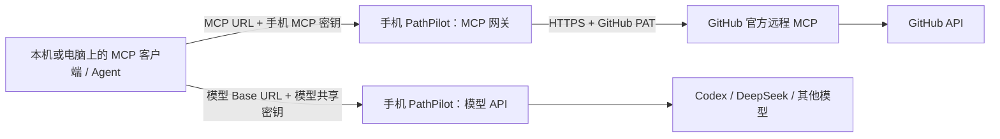

# 在手机上使用 MCP：GitHub 接入与实现方式

核查日期：2026-11-27（UTC）。PathPilot 当前实现远程 Streamable HTTP Tools 客户端与共享网关。本文说明手机实际负责的工作、GitHub 配置方法，以及从官方规范、Codex、Magpie、CC Switch 得到的实现取舍。

## MCP 在哪里运行

连接 GitHub 官方远程 MCP 时，**GitHub MCP 服务运行在 GitHub，PathPilot 的连接管理和共享网关运行在手机**。手机通过 HTTPS 使用它。



三者分工来自 [MCP 官方架构][spec-architecture]：服务提供工具，MCP client 维护连接，host 负责模型与工具之间的执行流程。PathPilot 当前没有内置完整 Agent 对话循环；手机上的其他 MCP 客户端或电脑上的 Codex 等 host 负责发现工具、把工具交给模型、执行调用，再把结果交回模型。

第三方软件需要同时支持模型 API 和 MCP：模型填写 OpenAI 兼容入口，GitHub 工具另填 MCP 入口。当前 `/v1/chat/completions`、`/v1/responses` 负责模型转发，工具执行由上述 host 完成。

## 为什么当前需要填写令牌

MCP 不要求用户手动创建令牌。Codex 的 MCP 登录会发现授权服务器、完成浏览器授权，再自动取得、保存和刷新 token；PathPilot 当前只实现了匿名连接与静态 Bearer 认证，尚未实现这条 OAuth 流程。[Codex OAuth 登录][codex-oauth] · [客户端注册][codex-registration]

界面里的凭据分属两层：

| 凭据 | 谁使用 | 用途 |
| --- | --- | --- |
| GitHub PAT、Context7 API Key | 手机上的 PathPilot | 访问对应远程服务，保持供应商原有格式 |
| 手机生成的 `sk-…` MCP 访问密钥 | 其他 MCP 客户端 | 访问 PathPilot 的本机或局域网入口 |

上游改用 OAuth 后，用户不再手填该服务的令牌，PathPilot 会管理授权结果；手机共享入口的访问密钥仍独立使用。模型 API 的共享密钥和 MCP 共享密钥也相互独立。

## 用当前 App 配置 GitHub

GitHub 官方 [README][github-readme] 同时提供 OAuth 与 PAT 两种远程接入方式。当前 App 使用 PAT；GitHub OAuth 尚未接入，下文说明所需的应用注册和 Android 实现路线。

1. 在 GitHub 的 [Personal access tokens](https://github.com/settings/personal-access-tokens) 中创建令牌，选择需要访问的账户、仓库和操作权限。令牌的权限决定 GitHub 工具实际可以做什么。
2. 打开 PathPilot 底部「MCP → 添加连接」，选择 GitHub，只填写个人访问令牌。地址与 Bearer 认证由预设提供；令牌字段只填令牌本身。
3. 添加后自动进入连接并获取工具。App 发送 `initialize`、`notifications/initialized`、`tools/list` 后显示实际目录；失败时保留连接，可点击「获取工具」重试。
4. 选择需要共享的工具，保持连接启用，打开「MCP 共享」。
5. 在连接详情选择「本机」或「局域网」，复制完整 MCP 地址及 **MCP 访问密钥**，填入支持 Streamable HTTP 的客户端。

预设保存的配置如下，也可通过「自定义连接」手动填写。之后编辑连接仍使用统一表单。

| 配置项 | 值 |
| --- | --- |
| 名称 | `GitHub` |
| URL | `https://api.githubcopilot.com/mcp/` |
| 认证 | `Bearer` |
| 令牌 | GitHub PAT，例如 `github_pat_…`，保留其原本格式 |

GitHub PAT 保存在手机，供手机访问 GitHub；客户端使用手机生成的 `sk-…` MCP 密钥访问 PathPilot。模型共享另有独立密钥与端口。

GitHub 官方还提供 `https://api.githubcopilot.com/mcp/readonly` 及指定 toolset 的路径。只查询代码时可以选只读入口；需要修改 issue、PR 等操作时使用相应工具与令牌权限。PathPilot 的逐工具开关控制对下游共享的工具，不替代 GitHub 的账户权限。[远程端点与 toolsets][github-remote]

GitHub 官方推荐 fine-grained PAT，可限定仓库并按用途选择 Contents、Issues、Pull requests、Actions 等读写权限；具体以所用工具对应的 GitHub API 权限为准。组织启用了 PAT 审批或 SSO 时，再完成相应步骤。[权限与组织策略][github-policies]

「获取工具」读取目录，GitHub API 在实际调用时检查 fine-grained PAT 权限。可先用客户端读取一个目标仓库的文件验证访问，再启用需要的写入工具。[工具目录与权限过滤][github-scopes]

## GitHub 登录授权的 Android 路线

GitHub 官方 [Host Integration][github-host] 明确远程 MCP 不支持动态客户端注册（DCR），需要事先注册 GitHub App 或 OAuth App。当前仓库没有供 PathPilot 使用的 GitHub client ID；现有 OpenAI Codex client ID 属于另一授权服务，不能用于 GitHub。

适合当前纯手机架构的路线是 **GitHub device flow**：项目维护者注册应用并启用设备授权，将公开的 client ID 配置到 App。用户点击登录后，App 获取验证码并打开 GitHub 授权页；用户登录并确认，App 按服务器给出的间隔轮询结果，将取得的 token 用于远程 MCP。普通用户无需创建 PAT。[GitHub 设备授权][github-oauth]

该流程只需要 client ID，**不需要 client secret**。GitHub 官方 OAuth App 文档也明确，设备授权生成的 token 在刷新时无需 client secret。相较之下，GitHub 网页授权流程即使使用 PKCE，换取 token 的参数仍要求 client secret；两种流程不能混为一谈。GitHub.com 已支持 PKCE，因此 Host Integration 中“即将支持 PKCE”和笼统的 secret 说明应以当前认证文档为准。[OAuth 参数与刷新流程][github-oauth] · [PKCE 支持范围][github-pkce]

这是 GitHub 专用授权适配，尚未实现，也不等于通用 MCP OAuth 已完成。接入还需要项目所属的 client ID、对应权限配置及真实账号联调；APK 无需存放静态 client secret。GitHub MCP 官方接受有效的 OAuth access token，具体仓库和工具权限由注册应用与用户授权决定。[GitHub MCP 认证][github-host]

## Context7 的认证状态

当前预设要求 Context7 API Key。最新 [README][context7-readme] 和 [Server Card][context7-constants] 将 Key 标为可选，但 [HTTP 认证源码][context7-auth] 的默认模式为 `required`；服务也可配置成允许匿名请求的 `observe` 模式。因此，托管服务是否允许无 Key 使用，应以实际响应为准，不能仅用 README 或源码默认值推断部署配置。

该版本源码已经提供 OAuth 受保护资源元数据、401 challenge 和 OAuth token 校验，并将普通交互授权指向 `https://clerk.context7.com`。[元数据与认证][context7-auth] · [端点实现][context7-http]。其注册统计包含 DCR 向 Client ID Metadata Documents 的迁移记录；客户端应读取实时授权服务器元数据，确认当前可用的注册方式。README 的 `ctx7 setup` 则描述另一条自动登录并生成 API Key 的安装流程。

本次对 GitHub MCP、Context7 MCP 及 Context7 授权服务器的元数据读取均被云代理在 CONNECT 阶段返回 `403 Forbidden`，未取得上游响应；尚未验证托管服务的匿名访问、DCR/CIMD 能力或账号授权结果。

## 在其他设备配置客户端

下面的 IP、连接 ID 和端口仅为示例，应复制手机页面的实际值：

| 使用位置 | MCP URL | 认证 |
| --- | --- | --- |
| 手机自身的 MCP 客户端 | `http://127.0.0.1:8318/mcp/<connectionId>` | `Bearer <手机MCP密钥>` |
| 同一局域网的电脑或其他手机 | `http://192.168.1.50:8318/mcp/<connectionId>` | `Bearer <手机MCP密钥>` |

电脑上的 Codex 可以在 `config.toml` 使用其官方支持的 HTTP 配置字段：

```toml
[mcp_servers.pathpilot_github]
url = "http://192.168.1.50:8318/mcp/<connectionId>"
bearer_token_env_var = "PATHPILOT_MCP_KEY"
```

在启动 Codex 的环境中将 `PATHPILOT_MCP_KEY` 设置为手机页面的 MCP 访问密钥。若客户端提供图形界面，直接填写同样的 URL 与 Bearer 密钥即可。Codex 配置中的 `url` 对应 Streamable HTTP；`command`、`args` 对应运行 Codex 的设备上的 stdio 进程。[Codex 配置类型源码][codex-config]

手机到 GitHub 的请求沿用 PathPilot 的上游代理设置。手机 VPN 对本 App 生效时，外网请求使用该 VPN；入站局域网访问仍需由手机网络和 VPN 的局域网设置允许。

## 当前实现与真实联调的区别

当前源码已经具备 GitHub PAT 方案所需的完整 URL、Bearer、HTTP POST、JSON/SSE 响应、工具分页和共享转发；这些路径已用离线上游验证。具体实现见 [McpClient](../core/src/main/kotlin/dev/pathpilot/core/mcp/McpClient.kt)、[McpGatewayServer](../core/src/main/kotlin/dev/pathpilot/core/mcp/McpGatewayServer.kt)、[McpService](../app/src/main/java/dev/pathpilot/app/runtime/McpService.kt)。

PathPilot 当前请求并只接受 `2025-11-25`。2026-11-27 的无凭据初始化尝试在云环境代理 CONNECT 阶段得到 `403 Forbidden`，未到达 GitHub。本次未使用用户 PAT，托管服务的版本协商和账号工具调用仍待联调。

所核查 GitHub 版本的 [go.mod][github-module] 使用 MCP Go SDK v1.8.0，该 SDK 的 [支持版本][go-versions] 包含 `2025-11-25` 与 `2026-07-28`，[服务端默认行为][go-server] 按客户端版本处理初始化。这说明源码具备当前 App 所需的版本路径；托管部署的版本集合以实际响应为准。

联调时按「获取工具」的具体结果处理：HTTP 401 检查令牌；GitHub 返回的 403 结合响应检查账户或组织策略；版本不匹配则记录服务版本并实现对应协议适配。代理 CONNECT 失败归于连接阶段。

## Codex、Magpie、CC Switch 分别可以借鉴什么

| 项目 | 已核查的 MCP 行为 | PathPilot 的采用方式 |
| --- | --- | --- |
| [Codex][codex-config] | host 维护 MCP 连接，将工具转换为模型可调用工具；支持 stdio、HTTP URL、Bearer 环境变量、headers 和单独的 OAuth 登录流程。 | 参考连接配置、工具调用边界和 OAuth 流程。当前先让 Codex 等客户端负责模型与工具执行循环；将来手机内增加 Agent 时，再实现这部分 host 能力。 |
| [Magpie][magpie-router] | MCP router 提供统一 HTTP 入口；连接远程 HTTP，也可启动并复用本机 stdio 进程；按来源和工具控制共享，关闭时回收自己启动的进程。可集中 OAuth 登录，向客户端分发本地代理入口。 | 当前远程网关方向与其一致。参考来源分组、工具开关、调用记录和集中认证；PathPilot 暂时保留每连接一个入口，不把聚合目录写成已完成。 |
| [CC Switch][cc-service] | 保存统一配置，并同步写入 Codex、Claude 等客户端自己的配置文件；连接检查可以启动 stdio 程序或连接 HTTP/SSE。 | 参考供应商/连接管理、表单和状态一致性。Android App 无法直接改写电脑上客户端的配置，先提供可复制入口与配置片段。它的桌面配置同步不等于手机工具运行时。 |

源码证据：Magpie 的 [`dialStdio` / `dialHTTP`][magpie-hub] 和 [集中登录后的代理配置][magpie-signin]；CC Switch 的 [Codex TOML 转换][cc-codex] 与 [连接检查][cc-connectivity]；Codex 的 [工具执行 handler][codex-handler] 和 [OAuth 登录入口][codex-login]。本次为源码核查，没有运行这三个参考项目。

## Android 后续实现顺序

1. **远程 HTTP 继续完善**：Microsoft Learn、OpenAI Docs、Context7、GitHub 四项静态预设已提供快捷添加，复用现有代理、存储和共享服务。接下来完成真实服务握手与工具目录记录，再扩展在线 Registry 搜索。预设字段与当前联调结果见 [远程 MCP 预设](mcp-presets.md)。
2. **集中 OAuth 登录**：GitHub 可按上面的设备授权路线接入；通用 MCP OAuth 则按受保护资源元数据发现授权服务器，优先使用已有预注册信息，其次使用服务器声明支持的 Client ID Metadata Documents，再按元数据支持情况使用 DCR。浏览器授权采用 Authorization Code + PKCE，并保存和刷新令牌。AppAuth-Android 可承担原生授权流程，但 MCP 发现、`resource` 参数和服务适配仍由本 App 实现。[MCP 认证][spec-auth] · [AppAuth-Android][appauth]
3. **具体手机本地工具**：例如用户选定文件的读取或手机状态查询，先实现原生 Kotlin 工具，复用 Tools 网关和 Android 文件授权，避免为少量工具引入整套脚本环境。
4. **通用本地 MCP 包**：确有 Node/Python/原生程序需求后，再评估内嵌运行时、ARM64 Android 构建、依赖下载、stdio 与服务生命周期。原生程序需面向 Android 的 ABI 和系统库构建；`.mcpb` 提供包格式，所需运行时由宿主配套提供。

通用 MCP OAuth 的客户端身份与回调地址由 PathPilot 配置，不能复用其他应用的注册信息。MCP 2025-11-25 要求授权回调使用 HTTPS 或 localhost，Android 可使用已验证的 HTTPS App Link；实际接入方式还需与服务公布的授权元数据对应。GitHub 设备授权不依赖这类浏览器回调。

远程目录、官方参考服务器与 MCPB 的详细来源见 [官方 MCP 来源与快捷接入](mcp-catalog-research.md)。上面的顺序是实施建议，不改变当前 App 的已验证范围。

[spec-architecture]: https://github.com/modelcontextprotocol/modelcontextprotocol/blob/b0be8f0f2481be8d5ea5294cf3fa57cd03cedc48/docs/specification/2025-11-25/architecture/index.mdx
[spec-auth]: https://github.com/modelcontextprotocol/modelcontextprotocol/blob/024d5255eb4466ba4fab21e044b5ba84d6a79327/docs/specification/2025-11-25/basic/authorization.mdx
[github-readme]: https://github.com/github/github-mcp-server/blob/7edc2dd123a8923db389de8772170663cb2d8e17/README.md
[github-remote]: https://github.com/github/github-mcp-server/blob/7edc2dd123a8923db389de8772170663cb2d8e17/docs/remote-server.md
[github-policies]: https://github.com/github/github-mcp-server/blob/7edc2dd123a8923db389de8772170663cb2d8e17/docs/policies-and-governance.md
[github-scopes]: https://github.com/github/github-mcp-server/blob/7edc2dd123a8923db389de8772170663cb2d8e17/docs/scope-filtering.md
[github-host]: https://github.com/github/github-mcp-server/blob/7edc2dd123a8923db389de8772170663cb2d8e17/docs/host-integration.md
[github-oauth]: https://github.com/github/docs/blob/df6faa250dc425fa137d270c967e6a74f12103a7/content/apps/oauth-apps/building-oauth-apps/authorizing-oauth-apps.md
[github-pkce]: https://github.com/github/docs/blob/df6faa250dc425fa137d270c967e6a74f12103a7/data/features/pkce_support.yml
[context7-readme]: https://github.com/upstash/context7/blob/f65b49389be58035d302d854a744f0fd329a1579/README.md
[context7-auth]: https://github.com/upstash/context7/blob/f65b49389be58035d302d854a744f0fd329a1579/packages/mcp/src/lib/mcp-http-auth.ts
[context7-constants]: https://github.com/upstash/context7/blob/f65b49389be58035d302d854a744f0fd329a1579/packages/mcp/src/lib/constants.ts
[context7-http]: https://github.com/upstash/context7/blob/f65b49389be58035d302d854a744f0fd329a1579/packages/mcp/src/index.ts
[github-module]: https://github.com/github/github-mcp-server/blob/7edc2dd123a8923db389de8772170663cb2d8e17/go.mod
[go-versions]: https://github.com/modelcontextprotocol/go-sdk/blob/v1.8.0/mcp/shared.go
[go-server]: https://github.com/modelcontextprotocol/go-sdk/blob/v1.8.0/mcp/server.go
[codex-config]: https://github.com/openai/codex/blob/afe555b9d3e95b4f58b247212565070f1555bc5d/codex-rs/config/src/mcp_types.rs
[codex-handler]: https://github.com/openai/codex/blob/32119bac269b881d512b82df74af285e8c60adc2/codex-rs/core/src/tools/handlers/mcp.rs
[codex-login]: https://github.com/openai/codex/blob/afe555b9d3e95b4f58b247212565070f1555bc5d/codex-rs/cli/src/mcp_login.rs
[codex-oauth]: https://github.com/openai/codex/blob/afe555b9d3e95b4f58b247212565070f1555bc5d/codex-rs/rmcp-client/src/perform_oauth_login.rs
[codex-registration]: https://github.com/openai/codex/blob/afe555b9d3e95b4f58b247212565070f1555bc5d/codex-rs/rmcp-client/src/oauth_client_registration.rs
[magpie-router]: https://github.com/yetone/magpie/blob/e66d872a8eaecc285b0d597917d6b520035712ec/docs/subsystems/mcp-router.md
[magpie-hub]: https://github.com/yetone/magpie/blob/e66d872a8eaecc285b0d597917d6b520035712ec/internal/library/mcp_hub.go
[magpie-signin]: https://github.com/yetone/magpie/blob/e66d872a8eaecc285b0d597917d6b520035712ec/internal/library/mcp_signin.go
[cc-service]: https://github.com/farion1231/cc-switch/blob/bf4cc69fe00e762a17d2ee40f409640cde8cef15/src-tauri/src/services/mcp.rs
[cc-codex]: https://github.com/farion1231/cc-switch/blob/bf4cc69fe00e762a17d2ee40f409640cde8cef15/src-tauri/src/mcp/codex.rs
[cc-connectivity]: https://github.com/farion1231/cc-switch/blob/bf4cc69fe00e762a17d2ee40f409640cde8cef15/src-tauri/src/services/mcp_connectivity.rs
[appauth]: https://github.com/openid/AppAuth-Android/blob/e5f51842fd1d3c7e49d9b6642e346f43f495dac8/README.md
