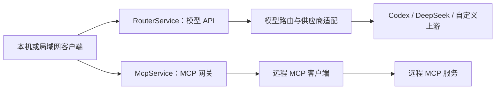

# 架构

PathPilot 由原生 Android 应用和纯 JVM 路由核心组成。当前代码分为 `app`、`core` 两个 Gradle 模块；具体版本与验证状态见 [项目状态](project-status.md)。

## 模块与职责

| 位置 | 职责 |
| --- | --- |
| `app/.../MainActivity.kt` 与页面文件 | Compose 导航、供应商/模型/共享/统计/MCP 页面 |
| `app/.../ui/` | 供应商编辑、图标、主题、字体与本地化错误展示 |
| `app/.../runtime/` | 加密配置、请求历史、地址发现、前台服务及运行状态 |
| `app/.../settings/` | 主题/语言偏好、备份格式、加解密与导入导出流程 |
| `core/.../RouterServer.kt`、`ResponseBridge.kt` | 模型 API 入口、路由、流式转发与 Codex 协议转换 |
| `core/.../codex/`、`providers/` | Codex 认证与模型目录、供应商配置与模型获取 |
| `core/.../mcp/` | 远程 MCP 客户端、工具目录与共享网关 |
| `core/.../network/` | 上游 HTTP/SOCKS5/系统代理配置 |

`core` 不依赖 Android，使用 OkHttp、Kotlin Serialization 和 NanoHTTPD。Android 层向它提供配置、凭据解析和观测回调，负责权限、文件、服务与界面。

## 请求路径

模型入口根据客户端 `model` 别名找到启用路由，再选中供应商和上游模型。自定义供应商与 DeepSeek 走其受支持的接口；Codex 通过固定官方 backend，并在需要时转换 Chat Completions 与 Responses。路由不隐式切换账号，也不自动重放生成请求。

MCP 入口按 `/mcp/<connectionId>` 定位远程连接，初始化会话、过滤工具目录并转发调用。当前实现 **2025-11-25 Streamable HTTP Tools**，支持 JSON/SSE、工具分页、会话释放及取消。OAuth、stdio 运行时、Resources、Prompts 与其他协议版本仍需专门适配。完整接口契约分别见 [模型 API](api.md) 和 [MCP](mcp-roadmap.md)。

模型与 MCP 共用上游代理设置；入口密钥只用于手机鉴权，上游使用各自保存的 API Key、Codex 会话或 MCP Bearer 令牌。

连接 GitHub 等官方远程 MCP 时，工具服务运行在供应商侧，手机运行连接管理与共享网关；模型与工具之间的执行循环由支持 MCP 的客户端/Agent 负责。远程服务配置不等于在手机安装其程序。GitHub PAT 接入、Codex 客户端配置和 Android 本地运行时的取舍见 [在手机上使用 MCP](android-mcp.md)。

## Android 服务与地址

`RouterService` 和 `McpService` 是两个独立的 `connectedDevice` 前台服务，各自持有监听器、通知及运行所需的锁。默认端口分别是 `8317` 和 `8318`；每个服务有自己的访问密钥与启停状态。

服务的 IO 协程拥有监听器和资源。停止时取消活动请求、关闭监听、释放锁；运行状态在清理完成后回到停止。`RouterRuntime`、`McpRuntime` 向界面发布正在启动、运行、正在停止及错误状态，不用持久化开关代替真实服务状态。

模型服务监听 IPv4 `0.0.0.0`。本机客户端使用 `127.0.0.1`，局域网客户端使用手机对应接口的 IP；地址选择仅影响展示与复制。`LocalAddresses` 发现实际网卡并区分 Wi-Fi、有线、VPN、蜂窝等来源，服务和前台页面随网络变化刷新。MCP 使用同一地址发现能力和独立端口。

## 配置与凭据

`AppStore` 持有 `RouterConfig`、`AppPreferences`、`McpSettings` 和 Codex 会话，通过 `StateFlow` 发布。配置由 Android Keystore 中的密钥执行 AES-GCM 加密，写入应用私有 `noBackupFilesDir` 下的 `AtomicFile`。写入成功后才发布新状态，存储失败不会伪装成保存成功。

Codex 刷新使用同步的凭据解析路径；已取得但尚未成功落盘的轮换令牌暂存于内存，先重试保存，不再次提交可能已失效的旧刷新令牌。配置无法解密时保留原文件并报告存储错误。

主题、Monet 开关和应用语言与其他配置共同持久化。Android 13+ 使用系统应用语言能力，较早版本由应用包装 Context；界面文案使用资源，服务通知读取当前应用语言。

## 记录与统计

模型请求由核心产生元数据，再经 `RequestHistoryStore` 写入本机 SQLite。保存最近 1,000 条，包含时间、模型/供应商快照、HTTP 状态、终态、耗时及实际返回的 Token；不保存提示词、回答或凭据。统计基于这些保留记录，不能作为完整账单或订阅配额。

`McpRuntime` 在内存保留最近 30 条工具调用元数据，重启 MCP 服务后清空。工具参数与结果正文不写入记录，也不计入模型 Token 统计。客户端随后把工具结果发给模型时，相关 Token 由那次模型响应的实际 `usage` 提供。

## 备份与恢复

`BackupCodec` 管理 `.ppbackup` 格式：PBKDF2-HMAC-SHA256（210,000 次）从用户口令派生密钥，AES-256-GCM 加密配置。备份包含供应商、密钥、路由、偏好及 MCP，Codex 会话可选；请求历史不包含在内。

`SettingsBackupViewModel` 管理文件选择、后台加解密、错误和恢复预览。恢复前检查模型与 MCP 服务已停止，解析并验证完整快照；默认保留目标手机的端口、共享密钥和上游代理。`AppStore.restoreBackup` 原子写入完整配置后再更新界面，恢复不启动服务。

## 界面与扩展原则

`MainActivity` 维护共享、模型、MCP、设置四个主导航目的地。模型首页按供应商组织，二级管理供应商配置与其共享模型；统计由模型页或请求入口进入，作为独立次级页面保留返回来源。供应商模型详情、MCP 详情和统计隐藏主导航，由对应层级处理返回。

选中的供应商、MCP 连接及统计入口参数由根页面管理，页面保存自己的滚动和筛选状态。共享开关、地址选择和密钥操作复用同一组件；模型和 MCP 的值分别来自各自配置与运行状态。页面不另存一份配置，也不在 Compose 点击回调中实现协议或持久化逻辑。

新增兼容 OpenAI 的供应商优先使用现有配置。不同认证或协议则在 `core` 增加明确适配，并在 Android 层提供相应接入界面。只有出现真实共享行为才抽取组件；当前两个模块足以承载这些职责，不为目录整齐额外增加运行框架。
